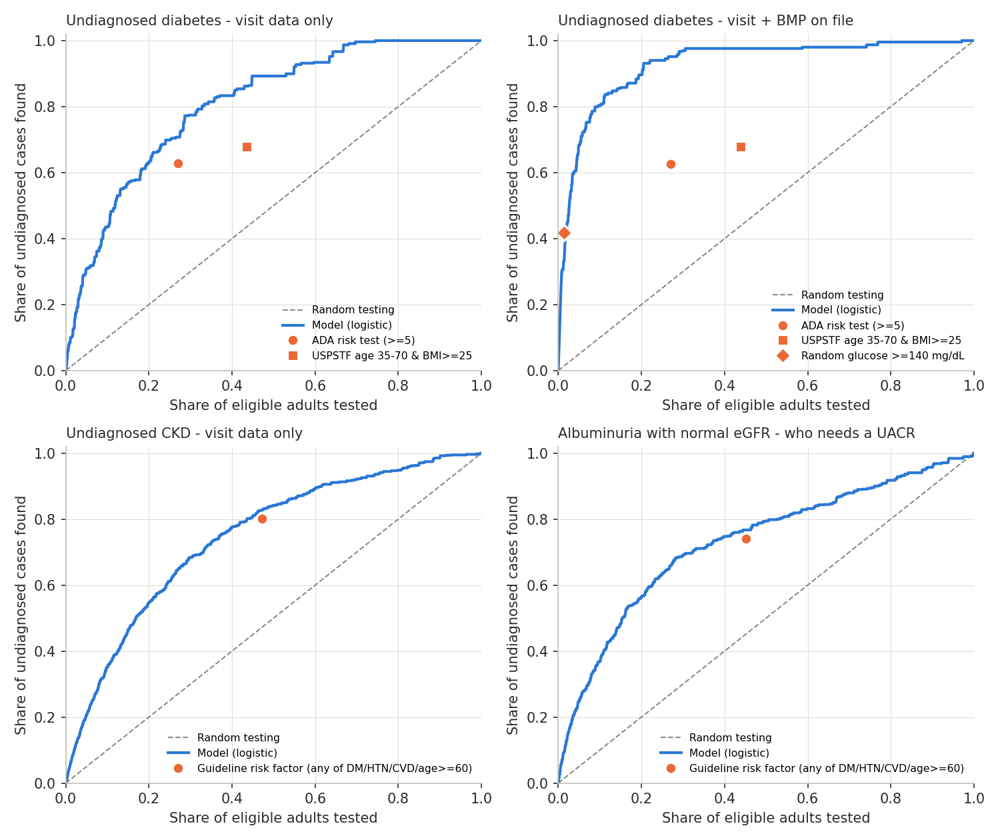
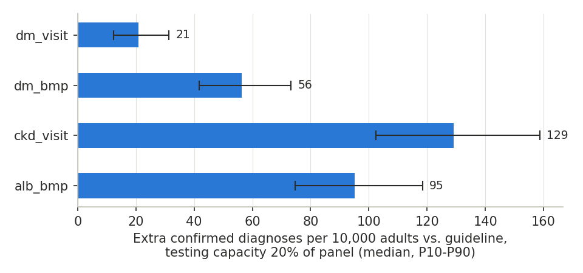
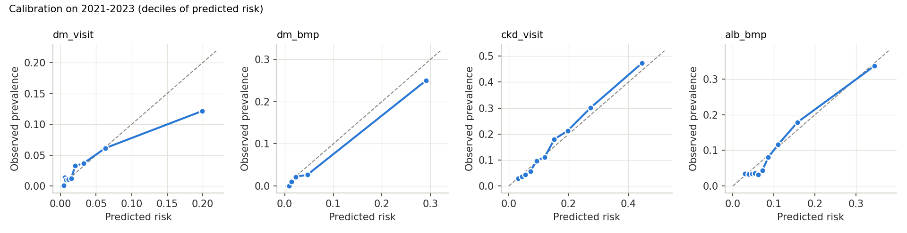
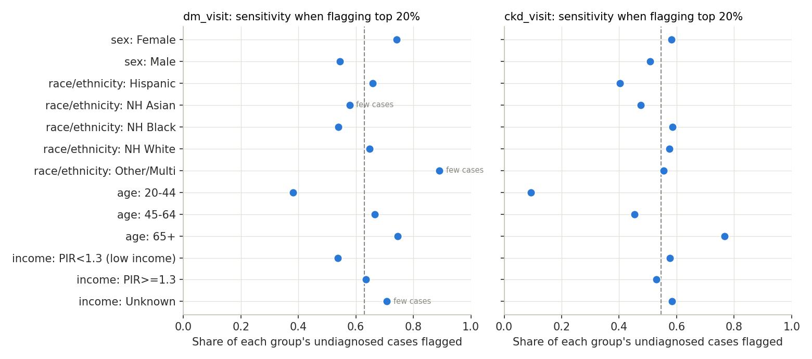

# Undiagnosed Chronic Condition Suspecting for Primary Care

**Which patients in a primary-care panel probably have diabetes or chronic kidney disease that nobody has diagnosed yet, and what is it worth to find them?**

This project builds and evaluates "suspecting" models of the kind a PCP-facing clinical assistant would use. It uses nationally representative, lab-confirmed data from NHANES. It compares the models against the screening guidelines clinics already follow. Then it turns the results into an impact forecast for a 10,000-patient panel, with uncertainty.

> **Headline (2021-2023 test cycle, survey-weighted):** With routine labs on file, the diabetes model reaches **AUROC 0.94** and finds **95% of undiagnosed cases** when testing the same number of adults as the ADA risk test, which finds 63%. With only visit data, it finds **86% vs. 68% for USPSTF** at the same testing volume. If a care team can test 20% of a 10,000-adult panel, the models add **~56 diabetes** and **~129 CKD** confirmed diagnoses over guideline-based selection, at 50-65% of the lab cost per diagnosis. Walkthrough: [`results.ipynb`](results.ipynb).

---

## Why this problem

- **About 1 in 5 US adults with diabetes doesn't know they have it. Most adults with CKD don't know either.** Both conditions get cheaper and easier to treat when they are caught early.
- **Primary care has limited capacity for outreach and testing.** The real question isn't "who is at risk?" but *"which patients should we test first, given a fixed budget?"*
- **Guidelines are blunt.** USPSTF recommends diabetes screening for adults aged 35-70 with overweight. CKD guidance says to test anyone with diabetes, hypertension, cardiovascular disease or age 60+. In an older (Medicare) panel, that is almost everyone, so the guideline no longer prioritizes anyone.
- **In value-based care, an undocumented condition goes untreated and also leaves the patient's risk score understated.** The goal is accurate diagnosis of real disease, so this project counts value only for conditions that are lab-confirmed and documented.

## Data

[NHANES](https://wwwn.cdc.gov/nchs/nhanes/) (CDC) combines interviews, physical exams and lab tests for a nationally representative sample. Because every participant gets the labs, we can see **who has the disease and also whether they were ever told**, which is exactly the "undiagnosed" label a health system cannot see in its own data.

| Role | Cycle | Files |
|---|---|---|
| Train / model selection | 2017-March 2020 (pre-pandemic) | `P_DEMO, P_GHB, P_DIQ, P_BIOPRO, P_ALB_CR, P_KIQ_U, P_BMX, P_BPXO, P_BPQ, P_MCQ, P_SMQ` |
| **Temporal external test** | August 2021-August 2023 | same components, `_L` suffix |

Training on one cycle and testing on a later one is a stand-in for deployment: the model has to survive a pandemic, a new sample design, and changed lab instruments and questionnaires.

## Prediction tasks

| Task | Eligible adults (20+, not pregnant) | Undiagnosed target | Inputs |
|---|---|---|---|
| `dm_visit` | No diabetes diagnosis | HbA1c ≥ 6.5% | Visit data only: age, sex, BMI, waist, measured BP, hypertension / cholesterol / CVD history, BP meds, family history, smoking, prediabetes told |
| `dm_bmp` | Same, with a basic metabolic panel on file | HbA1c ≥ 6.5% | Visit data + random serum glucose |
| `ckd_visit` | No kidney-disease diagnosis | eGFR < 60 **or** UACR ≥ 30 mg/g | Visit data + diabetes status |
| `alb_bmp` | No kidney diagnosis **and eGFR ≥ 60 on file** | UACR ≥ 30 mg/g | Visit data + glucose + eGFR |

`alb_bmp` targets a specific care gap. Low eGFR can be found straight from labs that are already on file. Albuminuria can only be found with a urine albumin-creatinine ratio (UACR) test, which is rarely ordered. This model decides **who needs a UACR**.

eGFR uses the race-free **CKD-EPI 2021** equation. **Race/ethnicity and income are not model inputs.** They are used only to audit performance across groups.

## Method

1. **Harmonize** two NHANES cycles into one schema (`src/ccs/data.py`). This handles renamed questions (for example, the BP-medication question changed from `BPQ050A` to `BPQ150`). A **schema-drift guard** drops any feature that is mostly missing in either cycle, so it can't silently shift test-time predictions.
2. **Baselines** (`src/ccs/baselines.py`): the ADA diabetes risk test (≥5), the USPSTF 2021 criteria, random glucose ≥140 mg/dL, and the guideline CKD risk-factor rule.
3. **Models** (`src/ccs/models.py`): an L2 logistic regression and a gradient-boosted tree model. One model is chosen using **training-cycle cross-validation only**, and the explainable model is preferred unless boosting wins by more than 0.01 AUROC. The logistic model also produces **per-patient reason codes**, the "why was this patient flagged" line a physician would see.
4. **Evaluation** (`src/ccs/evaluate.py`, `metrics.py`). Every metric is **survey-weighted** to the US adult population:
   - AUROC and AUPRC, calibration (observed/expected and calibration slope), and Brier score
   - **Head-to-head at the same testing volume as each guideline**: how many more cases the model finds when it tests the same number of people
   - Sensitivity, PPV, and tests needed per case found at alert budgets of 5/10/20/30%
   - Bootstrap 95% CIs, including CIs on the *difference* between the model and each guideline
   - A subgroup audit by sex, race/ethnicity, age and income, with small-sample flags
5. **Impact forecast** (`src/ccs/impact.py`): a care team can test 20% of a 10,000-adult panel. The **guideline strategy** tests eligible patients, chosen at random when more are eligible than capacity allows. The **model strategy** tests the top-ranked patients. A Monte Carlo combines bootstrap uncertainty in model performance with ranges for test completion, confirmation and documentation, lab cost, and $ per RAF point. The forecast reports extra confirmed diagnoses, lab cost per diagnosis, and, for the 65+ (Medicare Advantage-like) panel, the annual CMS-HCC V28 value of documenting those real conditions. It also includes a tornado-style sensitivity table. Every assumption is in `src/ccs/config.py`.

## Results

Train: NHANES 2017-March 2020. Test: NHANES August 2021-August 2023. Full tables are in [`reports/summary.md`](reports/summary.md), and the narrated walkthrough is in [`results.ipynb`](results.ipynb).

| Task | Test n (cases) | Model AUROC (95% CI) | Best guideline AUROC | Cases found at the guideline's testing volume: guideline → model |
|---|---|---|---|---|
| Undiagnosed diabetes, visit data | 4,911 (152) | 0.816 (0.772-0.856) | 0.767 (ADA) | 68% → 86% (USPSTF volume; +6 to +31 pts) |
| Undiagnosed diabetes, + routine labs | 4,665 (146) | **0.940** (0.916-0.962) | 0.765 (ADA) | 63% → 95% (ADA volume; +23 to +43 pts) |
| Undiagnosed CKD, visit data | 5,118 (791) | 0.783 (0.756-0.807) | 0.751 | 80% → 83% (+0.1 to +5 pts) |
| Albuminuria with normal eGFR | 4,778 (451) | 0.751 (0.712-0.789) | 0.707 | 74% → 77% (-1 to +7 pts) |

**Impact forecast** (10,000-adult panel, testing capacity 20%, median [P10-P90]): **+56 [42-73]** extra confirmed diabetes diagnoses when routine labs are available, **+129 [102-159]** CKD and **+95 [75-118]** albuminuria, with lab cost per diagnosis at 50-65% of the guideline strategy's. In a 65+ (Medicare Advantage-like) panel, documenting the extra confirmed diabetes and stage-3 CKD diagnoses is worth about **$230K and $160K per year** in CMS-HCC V28 risk adjustment, under the assumptions in `config.py`.

| | |
|---|---|
|  |  |
|  |  |

### What error analysis changed (v1 → v2)

1. **Survey weights.** v1 trained without NHANES weights. Because NHANES oversamples some groups, the models learned the sample's diabetes rate (4.2%) instead of the population's (2.7%), and over-predicted risk by about 1.6× (observed/expected 0.64; 0.51 for NH White adults). Survey-weighted training moved O/E to 0.85 for diabetes and 1.02 for CKD.
2. **Hidden signal in a missing value.** The top "reason" for diabetes flags was *prediabetes question unanswered*: people told they are "borderline" skip that question. v2 adds an explicit told-borderline feature, which is now the leading reason, and never shows missing-data indicators to physicians.
3. **Rules vs. models.** At very small volumes (~1.4% of patients), the rule "random glucose ≥ 140 mg/dL" finds more cases than the model (42% vs. 34%). A rule-first hybrid adds nothing from 5% capacity upward, so the recommendation is to keep the rule as a hard alert and use the model for outreach prioritization.

### Subgroup audit

At a 20% flag rate, CKD sensitivity is lower for Hispanic adults (40% vs. 57% for NH White), and risk is under-predicted for NH Black and NH Asian adults (O/E ≈ 1.27). Diabetes sensitivity is lower for men than women (54% vs. 74%). These are the checks to repeat on local data before deployment.

Example physician-facing suspect line (`reports/suspect_examples_dm_visit.csv`):
`p=0.59 · reasons: dx_borderline; waist=122; dbp=98`

## Run it

**Google Colab**

```python
!git clone https://github.com/Dorcas-Okaidjah/chronic-condition-suspecting.git
%cd chronic-condition-suspecting
!pip -q install -r requirements.txt
!python -m pytest -q tests          # 7 fast tests on synthetic data (no download)
!python run_all.py                  # downloads NHANES (~30 MB) on first run, ~2-4 min
```

**Locally**: the same commands without the `!`. `python run_all.py --synthetic` runs the whole pipeline on fake NHANES-shaped data, for checking the code only. Its numbers mean nothing.

Outputs in `reports/`: `summary.md` (all tables), `results.json`, `data_audit.csv` (missingness and prevalence sanity checks), `figures/`, `suspect_examples_*.csv`.

**Sanity checks to compare against published CDC figures**, printed at the start of every run: total diabetes prevalence and the undiagnosed share, and CKD prevalence and the unaware share. Our definitions use a single HbA1c and a single UACR measurement, so expect some differences from figures that use fasting glucose or confirmed persistence.

## Limitations

- **Single-visit definitions.** Clinical CKD requires abnormal results that persist for 3+ months, and diabetes is usually confirmed with a repeat test. A single UACR measurement overstates albuminuria, so treat `ckd_visit` and `alb_bmp` prevalence as upper bounds.
- **"Undiagnosed" means self-reported "never told".** Some participants were told and forgot. Kidney-disease awareness questions are known to under-report.
- **NHANES is not an EHR.** A real deployment would draw on claims, problem lists and lab history, which carry more signal and more missingness. The point here is a rigorous, reproducible evaluation design that transfers to that setting.
- **Family history of diabetes (`MCQ300C`) is not in the 2021-2023 public files.** The schema-drift guard drops it from every model, and the ADA risk-test baseline loses that item (worth 1 point) on the test cycle. This slightly handicaps the ADA baseline. The USPSTF and CKD baselines are unaffected.
- **Reason codes come from the logistic model.** When the gradient-boosted model does the ranking (`ckd_visit`), the reasons explain the patient's risk in interpretable terms but are not an exact decomposition of the GBM score.
- **The financial values are illustrative.** RAF coefficients are CMS-HCC V28 community non-dual aged reference values (diabetes HCC 38 = 0.166; CKD stage 3 HCC 329 = 0.127). Albuminuria-only CKD (stages 1-2) has no payment HCC and is valued at $0. The $ per RAF point is an assumed range. Revenue is never the target: the target is diagnosing real disease so it can be treated.

## Repository layout

```
run_all.py            end-to-end pipeline
results.ipynb         narrated results walkthrough (reads reports/)
src/ccs/config.py     NHANES specs, thresholds, impact assumptions (one place to challenge)
src/ccs/data.py       download, cache, harmonize; synthetic data generator for tests
src/ccs/cohort.py     phenotypes and the four prediction tasks
src/ccs/baselines.py  guideline screening rules
src/ccs/models.py     model candidates, CV selection, reason codes
src/ccs/metrics.py    survey-weighted metrics, bootstrap
src/ccs/evaluate.py   train -> test evaluation, matched comparisons, subgroup audit
src/ccs/impact.py     panel impact forecast (Monte Carlo + tornado)
src/ccs/report.py     figures and summary.md
tests/                pytest suite (no network needed)
```
